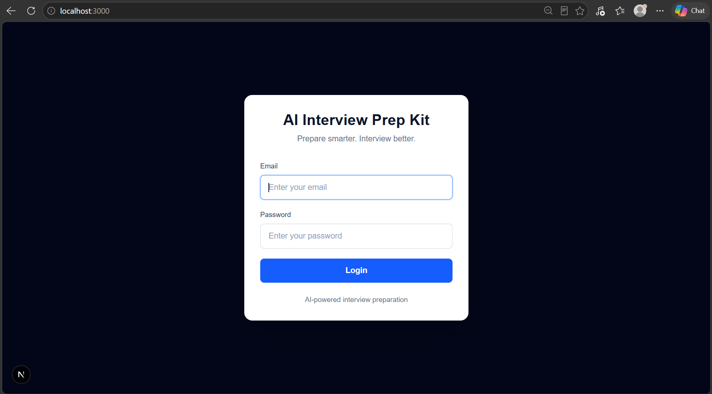
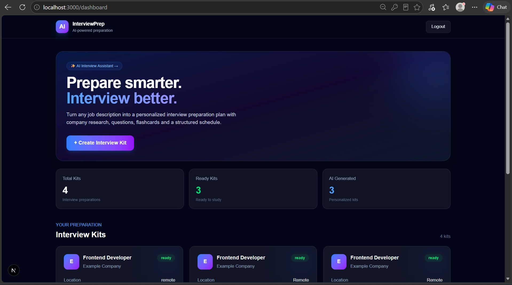
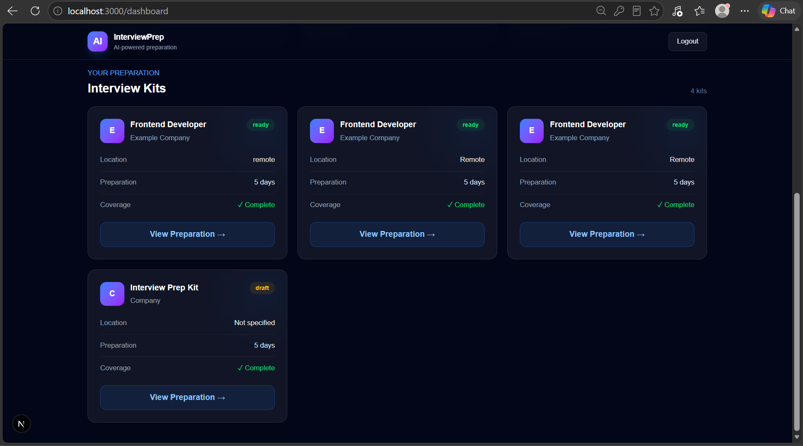
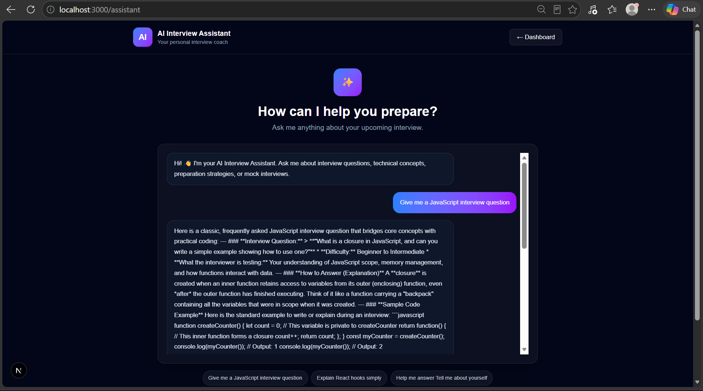
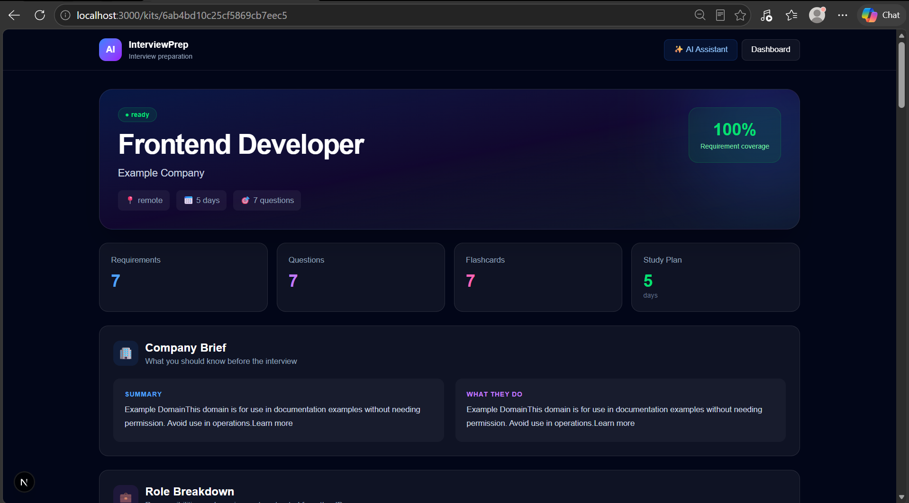

# AI Interview Prep Kit

An AI-powered full-stack application that transforms a job description and company website into a structured, personalized interview preparation kit.

## Application Screenshots

### 1. Login


### 2. Dashboard


### 3. Interview Kits


### 4. AI Interview Assistant


### 5. Generated Interview Preparation Kit


## Features

- User registration and login
- Interview kit generation from job descriptions
- Company research and website content retrieval
- Requirement extraction with must-have and nice-to-have classification
- Categorized technical interview questions
- AI-generated flashcards
- Deterministic requirement coverage checking
- Coverage repair for missing requirements
- Day-by-day study schedule generation
- Persistent storage using MongoDB
- AI Interview Assistant for interview preparation
- Responsive Next.js user interface
- Batch evaluation pipeline for testing generation quality

## Technology Stack

### Frontend
- Next.js
- React
- TypeScript
- Tailwind CSS

### Backend
- Node.js
- Express.js
- TypeScript
- MongoDB
- Mongoose
- JWT authentication
- Zod validation

### AI Integration
- Google Gemini
- Configured model: `gemini-3.6-flash`

### Website Retrieval
- Axios
- Cheerio
- Website link discovery
- URL safety checks
- Robots.txt checks

## Architecture

```text
Next.js Frontend
       |
       v
Express API
       |
       +--> Authentication
       |
       +--> Interview Kit Pipeline
       |       |
       |       +--> Requirement Extraction
       |       +--> Company Research
       |       +--> Company Brief
       |       +--> Question Generation
       |       +--> Coverage Check
       |       +--> Coverage Repair
       |       +--> Flashcards
       |       +--> Schedule Allocation
       |       +--> Validation
       |
       +--> MongoDB
       |
       +--> Google Gemini
       |
       +--> Website Retrieval
               |
               +--> Axios
               +--> Cheerio
               +--> URL Safety Checks
               +--> Robots.txt Checks
```

## How It Works

1. The user registers or logs in.
2. The user submits a job description and relevant company information.
3. The backend extracts job requirements and researches the company.
4. The kit pipeline generates a company brief, categorized interview questions, flashcards, and a study schedule.
5. A coverage checker evaluates whether the extracted requirements are addressed.
6. The coverage repair step attempts to address missing requirements.
7. The generated preparation kit is validated and stored in MongoDB.
8. The user reviews the preparation materials and can ask additional questions through the AI Interview Assistant.

## Project Structure

```text
ai-interview-prep-kit/
├── backend/
│   ├── scripts/
│   ├── src/
│   │   ├── config/
│   │   ├── controllers/
│   │   ├── middleware/
│   │   ├── models/
│   │   ├── routes/
│   │   ├── services/
│   │   ├── utils/
│   │   └── server.ts
│   ├── tests/
│   └── README.md
├── frontend/
├── docs/
│   └── screenshots/
│       ├── 01-login.png
│       ├── 02-dashboard.png
│       ├── 03-interview-kits.png
│       ├── 04-ai-assistant.png
│       └── 05-generated-kit.png
├── README.md
└── package.json
```

## Getting Started

### Prerequisites

- Node.js and npm
- MongoDB configured for the application
- A Google Gemini API key
- Git

### 1. Clone the repository

```bash
git clone https://github.com/sahithibandaru23/ai-interview-prep-kit.git
cd ai-interview-prep-kit
```

### 2. Install dependencies

Install the root dependencies if the root `package.json` defines them:

```bash
npm install
```

Install frontend dependencies:

```bash
cd frontend
npm install
```

Install backend dependencies in a separate terminal:

```bash
cd backend
npm install
```

### 3. Configure environment variables

Review `.env.example` and the application configuration files for the required environment variables.

Configure the database connection, JWT authentication secret, Gemini API key, and any frontend API URL required by the project.

Use the exact variable names expected by the code.

**Never commit real credentials, API keys, JWT secrets, or `.env` files to GitHub.**

### 4. Run the backend

From the `backend` directory, run the development script defined in `backend/package.json`. For example, if the script is named `dev`:

```bash
npm run dev
```

### 5. Run the frontend

From the `frontend` directory, run the development script defined in `frontend/package.json`. For example:

```bash
npm run dev
```

Open the local URL printed by the frontend development server. The current local setup uses:

http://localhost:3000

> Verify the package scripts, environment variables, and database configuration before following these steps on a new machine.

## Evaluation

The project includes a batch evaluation pipeline for checking interview-kit generation behavior against defined test cases.

Review the backend scripts and test configuration for the available evaluation commands and test coverage.

## Future Improvements

- Improve company research accuracy and source attribution.
- Expand automated tests for authentication and kit generation.
- Improve error handling for unavailable websites and AI service failures.
- Add more interview practice and preparation progress tracking.
- Document deployment configuration and API endpoints.

## Author

**Bandaru Sahithi**

- LinkedIn: https://www.linkedin.com/in/sahithi-bandaru-b36abb278
- GitHub: https://github.com/sahithibandaru23
- Project Repository: https://github.com/sahithibandaru23/ai-interview-prep-kit
